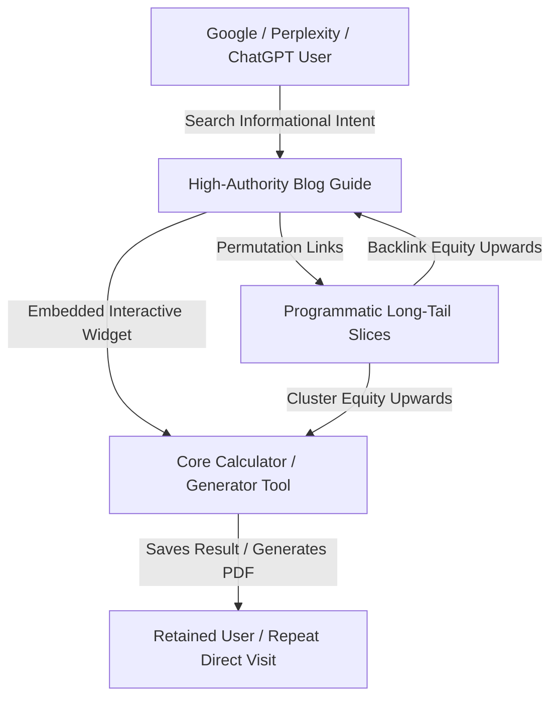

# 🌐 Universal Modern Web SEO, pSEO & AI Search (AEO/GEO) Architecture Blueprint

A production-grade, framework-agnostic architectural playbook for building high-ranking web applications with automated schema generation, programmatic scaling (pSEO), and AI search engine citation readiness.

---

## 📊 Architectural Pillars Overview

| Core Pillar | Technical Mechanism | Search & AI Engine Impact |
| :--- | :--- | :--- |
| **Indexation & Crawlability** | Dynamic XML Sitemap + Clean `robots.txt` | Ensures 100% crawl budget efficiency and real-time route discovery |
| **Rich Structured Data** | JSON-LD Schemas (`WebApplication`, `FAQPage`, etc.) | Triggers Google SERP rich snippets, interactive app cards & FAQ accordions |
| **Programmatic SEO (pSEO)** | Parameterized dynamic route generator | Scales from tens of pages to thousands of long-tail intent landing pages |
| **Keyword Architecture & Intent** | Pillar-and-spoke clustering + Semantic LSI | Dominates search intent tiers without cannibalization |
| **AI Search Optimization** | `llms.txt` + `Dataset` + `SpeakableSpecification` | Feeds concise facts into LLMs (Perplexity, ChatGPT, Claude, Gemini) |
| **Core Web Vitals & Telemetry** | Non-blocking telemetry (`afterInteractive`) | Preserves 95+ Lighthouse scores with zero First-Contentful-Paint delay |

---

## 1. Schema.org Structured Data Matrix

Inject all schemas as JSON-LD (`<script type="application/ld+json">`) dynamically per route.

### ① Application & Tool Schema (`WebApplication` / `SoftwareApplication`)
* **When to use**: Any interactive calculator, converter, generator, editor, or web utility.
* **Why it matters**: Triggers Google interactive app cards, software entity badges, and zero-price indicators on SERPs.
* **Core properties**:
  * `name`, `description`, `url`
  * `applicationCategory`: Match specific industry categories (e.g. `FinanceApplication`, `BusinessApplication`, `UtilityApplication`, `EducationalApplication`).
  * `operatingSystem`: `All (Web Browser, iOS, Android)`
  * `offers`: Explicitly specify `price: 0` and currency to earn the "Free" badge on search listings.

### ② Expandable SERP Accordions (`FAQPage`)
* **When to use**: Landing pages, category hubs, tools, and informational guides.
* **Why it matters**: Expands your search snippet height by up to 2.5× on mobile and desktop search results, dramatically increasing Click-Through Rate (CTR).
* **Core properties**:
  * `mainEntity`: Array of `Question` and `acceptedAnswer`.
  * *Best Practice*: Write the first sentence of the answer as a direct, punchy fact before providing additional details.

### ③ Hierarchical Navigation Trails (`BreadcrumbList`)
* **When to use**: Every page below the root homepage.
* **Why it matters**: Replaces raw, confusing URL slugs in search results with clean category navigation trails (e.g. `Home > Category > Specific Tool`).
* **Core properties**:
  * 1-indexed `ListItem` array with `position`, readable `name`, and absolute canonical `item` URL.

### ④ Generative Engine Optimization (`Dataset` Schema)
* **When to use**: Any page presenting tables, statutory rates, tariff schedules, pricing tiers, or structured matrices.
* **Why it matters**: AI search crawlers (Perplexity, ChatGPT Search, Gemini) parse `Dataset` schemas directly into their context window, significantly increasing your platform's citation rate.
* **Core properties**:
  * `name`, `description`, `keywords`, `creator`, `license` (e.g. CC-BY-4.0), and `isAccessibleForFree: true`.

### ⑤ Voice & Direct Answer Extraction (`QAPage` + `SpeakableSpecification`)
* **When to use**: Key definition blocks, formulas, and primary answer containers.
* **Why it matters**: Directs voice assistants (Google Assistant, Siri) and AI summarizers directly to the exact HTML element holding the answer.
* **Core properties**:
  * `SpeakableSpecification` targeting exact CSS selectors (e.g. `.direct-answer`, `h1`, `p`).

### ⑥ Authority & News Distribution (`Article` / `BlogPosting`)
* **When to use**: Educational blogs, documentation, walkthroughs, and news updates.
* **Why it matters**: Qualifies content for Google Discover, Google News, and carousel highlights.
* **Core properties**:
  * `headline`, `image`, `datePublished`, `dateModified`, `author` (Person or Organization), and `publisher`.

---

## 2. Dynamic Sitemap & Scalable Routing Pipeline

Avoid manual XML sitemaps. Build a dynamic generation pipeline that updates automatically as content and parameters scale.

### Sitemap Routing Hierarchy
1. **Root & Core Landings (`priority: 1.0`, `changefreq: 'daily'`)**: The primary brand and conversion hubs.
2. **Category Hubs & Taxonomies (`priority: 0.9`, `changefreq: 'daily'`)**: Section pillars that group related tools or topics together.
3. **Core Interactive Pages (`priority: 0.85`, `changefreq: 'weekly'`)**: High-intent tools, calculators, and feature pages.
4. **Programmatic Permutation Slices (`priority: 0.70`, `changefreq: 'weekly'`)**: High-volume, granular long-tail target pages.
5. **Guides & Articles (`priority: 0.75`, `changefreq: 'monthly'`)**: Top-of-funnel educational articles with publication dates.

---

## 3. Programmatic SEO (pSEO) Architectural Engine

Programmatic SEO captures high-volume, low-difficulty search queries by generating dedicated, indexable landing pages from a structured data model rather than writing individual pages by hand.

### The 4-Step Implementation Model:
1. **Define the Permutation Matrix**:
   * *Formula*: `[Core Verb / Action] + [Modifier / Unit / Value / Location / Tier]`
   * *Patterns*:
     * Dimension conversions: `[Unit X] to [Unit Y]`
     * Bracket lookups: `[Tier / Value] + [Calculation / Formula]`
     * Comparative evaluations: `[Option A] vs [Option B]`
     * Geo-localized services: `[Tool / Service] in [Region / City]`
2. **Deterministic Seed Data**:
   * Pre-define high-demand parameter combinations in structured configuration files or headless databases.
   * Pre-render routes at build time (`generateStaticParams` / SSG) for instant server response times (<50ms TTFB).
3. **Dynamic Template Composition**:
   * All programmatic pages share a high-converting layout engine that dynamically generates:
     * Unique title, meta description, and target `<h1>`
     * Instant pre-calculated answer card (no interaction needed to see the result)
     * Step-by-step formula breakdown explaining the calculation
     * Context-specific FAQ with matching `FAQPage` schema
     * Cross-linking graph to neighboring permutations
4. **Thin Content Safeguards**:
   * Avoid Google duplicate content penalties by ensuring every generated slice provides distinct mathematical, visual, or contextual data.

---

## 4. AI Engine Optimization (AEO & GEO) & `llms.txt`

Traditional SEO targets crawler indexing; modern SEO targets **LLM context ingestion**.

### ① The `llms.txt` Standard (`/public/llms.txt`)
* Serve a clean, structured Markdown file at `/llms.txt`.
* Summarize your platform's core definitions, official formulas, authoritative ratios, regulatory sources, and canonical tool routes.
* Allows AI web crawlers (Perplexity, ChatGPT, Claude) to read your entire platform's authority layer in a single compressed token payload without executing JavaScript.

### ② Content Chunking for AI Extraction
* **Inverted Pyramid Layout**: The very first sentence under any `<h2>` or `<h3>` must directly answer the core user question before giving explanations.
* **Semantic HTML First**: AI parsers heavily prioritize `<table>`, `<ul>`, `<ol>`, and `<dl>` over unstructured text blocks when generating comparison answers.

---

## 5. Technical & On-Page Foundational Standards

### ① Centralized Metadata Factory
Centralize metadata creation in a single helper to enforce uniformity:
* **Absolute Canonical URLs**: Always use absolute URLs. Relative URLs can cause duplicate indexing issues across subdomains or HTTP/HTTPS.
* **Title Strategy**: `[Page Specific Topic] — [Value Proposition] | [Platform Name]` (Keep under 60 characters).
* **Meta Description**: 130–155 characters featuring primary keyword intent and a clear call-to-action.
* **Open Graph & Twitter Cards**: High-resolution image (1200×630px), explicit dimensions, and `summary_large_image`.
* **Robots Directives**:
  ```ts
  robots: {
    index: true,
    follow: true,
    googleBot: {
      index: true,
      follow: true,
      'max-video-preview': -1,
      'max-image-preview': 'large',
      'max-snippet': -1,
    },
  }
  ```

### ② Bot Access Control (`robots.txt`)
* Allow all standard web search crawlers (`User-agent: *`, `Allow: /`).
* Disallow authenticated, dynamic cart, checkout, or private backend API endpoints (`Disallow: /api/`).
* Declare the canonical dynamic sitemap at the bottom (`Sitemap: https://yourdomain.com/sitemap.xml`).

### ③ Semantic DOM & Accessibility UX
* **Single `<h1>`**: Exactly one `<h1>` per page reflecting the primary search intent.
* **Descriptive ARIA Labels**: Add `aria-label` and `role` to interactive buttons, form inputs, and modal controls (accessibility is a proven search ranking signal).
* **Zero CLS & Preloading**: Preload primary typography and critical CSS to maintain Cumulative Layout Shift below `0.05`.

---

## 6. Non-Blocking Telemetry & Analytics Architecture

1. **Script Loading Strategy**:
   * Load analytics tags (e.g. Google Analytics, Plausible, PostHog) with non-blocking execution (`strategy="afterInteractive"` or `defer`).
   * Never let tracking scripts delay the First Contentful Paint (FCP) or Largest Contentful Paint (LCP).
2. **Resilient Configuration Pattern**:
   * Support environment variables (`process.env.NEXT_PUBLIC_GA_ID`) with clean fallback defaults so local development and preview deployments never break or throw runtime exceptions.
3. **Automatic Route Telemetry**:
   * Attach tracking at the root application layout so client-side navigation automatically records accurate virtual page views without manual triggers.

---

## 7. Strategic Keyword Architecture, Intent Mapping & Semantic Clustering

A scalable web application must structure its keyword strategy around search intent tiers and topic clusters rather than randomly assigning keywords across pages.

### ① Intent Tiers & Route Mapping
1. **Navigational & Brand Intent** (`[Brand Name]`, `[Tool Name] Official`):
   * *Target*: Root Homepage.
   * *Objective*: Instant SERP domination with brand sitelinks and direct navigation.
2. **Commercial & Transactional Utility Intent** (`[Action] Calculator`, `[Document] Generator`, `[Metric] Converter`):
   * *Target*: Dedicated Core Tool & Feature Pages.
   * *Objective*: Users arrive ready to calculate, convert, or generate immediately with minimal friction.
3. **Informational & Educational Intent** (`How to calculate [X]`, `What are the rules of [Y]`, `[Topic] guide`):
   * *Target*: Topic Guides / Blog Posts with embedded interactive tool widgets.
   * *Objective*: Top-of-funnel traffic capture that funnels directly into your core transactional tools.
4. **Hyper-Specific Long-Tail Intent** (`[Specific Value] [Unit A] to [Unit B]`, `[Tier] [Category] rate`):
   * *Target*: Programmatic SEO (pSEO) permutation slices.
   * *Objective*: Zero-competition, instant answer cards capturing high-conversion long-tail queries.

### ② The Pillar-and-Spoke Clustering Model
To build unshakeable topical authority and prevent keyword cannibalization:
* **The Pillar (Category Hub)**: Targets the high-volume head keyword (e.g. `Finance & Accounting`, `Legal Contracts`, `Unit Converters`).
* **The Core Spokes (Primary Tools)**: Target mid-tail high-intent keywords (e.g. `Tax Calculator`, `Lease Agreement Generator`).
* **The Micro-Spokes (pSEO Pages)**: Target exact long-tail queries (e.g. `10k Monthly Salary Tax`, `Commercial Lease Agreement Form`).
* **Internal Linking Graph**: Micro-spokes link back up to their Core Spoke; Core Spokes link back to the Pillar Hub. Search crawlers recognize the complete topical authority hierarchy.

### ③ On-Page Keyword Placement Hierarchy
For maximum search relevance without keyword stuffing:
1. **URL Slug**: Keep it short, clean, hyphen-separated, containing the primary keyword (e.g. `/rent-agreement` not `/page?id=12`).
2. **Title Tag**: Primary keyword placed as close to the beginning as possible (`[Primary Keyword] — [Value Proposition] | [Brand]`).
3. **Primary Heading (`<h1>`)**: Matches the title's core target intent directly.
4. **First 100 Words**: Natural usage of the primary keyword and its exact semantic definition.
5. **Secondary Headings (`<h2>`, `<h3>`)**: Target secondary variations, related search questions, and "How it works" queries.
6. **Semantic LSI & Co-Occurrence Terms**: Include natural terminology that search engines expect in the topic domain (e.g. on a loan page: interest rate, tenure, amortization, monthly installment, principal balance).

### ④ Multilingual & Multi-Script Keyword Strategy
When addressing regional, international, or bilingual audiences:
* **Script Variants in Meta & Content**: Users frequently search in both the Latin alphabet (`romanized / transliterated`) and native scripts (Devanagari, Arabic, Cyrillic, Kanji, etc.).
* **Targeting Both Script Modalities**:
  * Include native script terms and transliterated queries in the `keywords` array and FAQ schema.
  * Embed secondary script terms within descriptive subheadings or language toggles so search crawlers index both language modalities for the same page.
* **Hreflang & Canonical Coordination**: If operating dedicated multi-language subpaths (`/en/`, `/es/`, `/np/`), implement bidirectional `hreflang` tags to indicate regional and linguistic equivalence without duplicate content flags.

---

## 8. Low-to-Medium Competition Keyword Research Playbook

A practical, step-by-step methodology to uncover untapped, low-to-medium competition keywords (KD < 30) that rank rapidly and drive high-intent transactional traffic.

### ① The 3-Tier Keyword Prioritization Framework
| Tier | Monthly Volume | Keyword Difficulty (KD) | Intent / Page Type | Ranking Velocity |
| :--- | :--- | :--- | :--- | :--- |
| **Tier 1: Quick-Win Micro Queries** | 50 – 500 | KD 0 – 15 | Hyper-specific long-tail / pSEO slices | 48 hours – 2 weeks |
| **Tier 2: Core Utility Keywords** | 500 – 5,000 | KD 15 – 35 | Dedicated interactive tools & generators | 3 weeks – 2 months |
| **Tier 3: Pillar Category Anchors** | 5,000 – 50,000+ | KD 40+ | Pillar category hubs & master landing pages | 3 months – 6+ months (via cluster accumulation) |

### ② The SERP Vulnerability Audit (Finding "Easy Wins")
Before targeting any keyword, perform a manual or automated SERP check. If you see any of these **vulnerability signals** in Google's Top 5 results, the keyword has low competition and can be easily overtaken:
1. **User Intent Mismatch**: The top results are outdated forum threads, Reddit posts, Quora answers, or raw PDF documents because no dedicated web tool exists.
2. **Missing Exact Title Matches**: Competitor `<title>` tags do not contain the exact search phrase.
3. **Thin Text Content vs Interactive Utility**: If top competitors rank with a 300-word blog post, creating an interactive, zero-click calculator/generator immediately claims the #1 position.
4. **Low Domain Authority (DA < 25)**: Websites with few backlinks ranking in the top 3 spots confirm minimal ranking barriers.

### ③ The Keyword Golden Ratio (KGR) Formula
For brand-new domains or recently launched sections, use the KGR rule to rank on Page 1 without backlinks:
$$\text{KGR} = \frac{\text{Google Search Results with Exact Phrase in Title (allintitle:)}}{\text{Monthly Search Volume (under 250)}}$$
* **KGR < 0.25 (Green / Priority)**: Very low competition. When you publish a dedicated page, it typically ranks in the top 50 within days and moves to Page 1 quickly.
* **KGR 0.25 – 1.0 (Yellow / Moderate)**: Medium competition. Requires good on-page optimization and internal linking from a pillar hub.
* **KGR > 1.0 (Red / Competitive)**: High competition. Do not target as a standalone page until topical authority is established.

### ④ The "Modifier Stacking" Mining Method
Uncover hundreds of low-competition keywords by combining root industry entities with high-intent intent modifiers:

$$\text{Root Entity} + \text{Utility Modifier} + \text{Constraint / Qualifier}$$

* **Utility Modifiers**:
  * `calculator`, `converter`, `generator`, `estimator`, `checker`, `builder`, `template`, `formula`, `chart`, `rates today`, `schedule`.
* **Constraint Modifiers**:
  * `free`, `online`, `without login`, `download pdf`, `instant`, `step by step`, `for beginners`, `rules`, `comparison`.
* **Dynamic Modifiers (pSEO Fuel)**:
  * By year/statute (`2026`, `FY 83/84`), by unit (`per sq ft`, `per tola`, `in kg`), by bracket (`under 50k`, `10 lakh`).

### ⑤ Zero-Cost Discovery Workflows
1. **Google Autocomplete & "Alphabet Soup"**:
   * Type: `[root tool keyword] + a`, `[root tool keyword] + b` in incognito mode.
   * Google will autocomplete real search queries typed by users with active volume.
2. **"People Also Ask" (PAA) Scraping**:
   * Click open 3–4 questions in the PAA box; Google dynamically expands 20+ related conversational questions.
   * Turn each question into a direct H2/H3 FAQ with an accompanying `FAQPage` schema.
3. **Google Search Console (GSC) Query Expansion**:
   * Inspect existing pages in GSC under **Performance > Pages > Queries**.
   * Filter for queries with high impressions but low average position (positions 8–20).
   * Either optimize the current page for that query or spin it off into its own dedicated long-tail pSEO page to capture the #1 position.

### ⑥ Advanced Search Operators & Keyword Filtering Commands (Include vs Exclude Matrix)

When querying search engines or keyword research tools (Google Keyword Planner, Ahrefs, Semrush, OpenSEO), use structured Boolean commands with **exact inclusion and exclusion rules** to strip out junk queries and surface pure high-intent transactional queries.

#### Master Google Boolean Discovery Commands
```bash
# 1. Find untapped high-intent calculators / tools in Nepal:
allintitle:"nepal" (calculator OR converter OR generator OR tax OR charges OR fee) -jobs -vacancy -syllabus -routine -result -login -portal -apk

# 2. Find weak competitor SERPs (Forums, Quora, Reddit ranking for financial/legal queries):
("how to calculate" OR "kasari hisab garne" OR "rate today") (site:reddit.com OR site:quora.com OR site:facebook.com) "nepal"

# 3. Find Diaspora / International remittance and tax queries (USA, UK, Australia, Europe):
("send money to nepal" OR "remittance tax" OR "noc tax" OR "nre account" OR "forex rates") (USA OR UK OR Australia OR Europe OR "Gulf") -jobs -vacancy -visa

# 4. Find government statutory gazette rules lacking interactive tools:
("ऐन" OR "नियमावली" OR "कार्यविधि" OR "दस्तुर" OR "शुल्क") filetype:pdf "२०८०" OR "२०८१" OR "२०८२" OR "२०८३"
```

#### Keyword Filter Matrix: What Words to INCLUDE vs EXCLUDE

| Dimension | Words to INCLUDE (High Buyer & Utility Intent) | Words to EXCLUDE (Negative Keywords / Noise to Blacklist) |
| :--- | :--- | :--- |
| **Utility & Transaction** | `calculator`, `converter`, `generator`, `estimator`, `checker`, `builder`, `today rate`, `current price`, `charges`, `fee`, `cost` | `free download`, `crack`, `mod apk`, `hack`, `torrent`, `license key`, `activation code` |
| **Rules & Actionable Intent** | `how to calculate`, `formula`, `rules`, `slabs`, `step by step`, `process`, `documents required`, `eligibility`, `sample`, `template`, `format` | `jobs`, `vacancy`, `careers`, `salary of employee at`, `internship`, `interview questions` |
| **Educational & Academic Noise** | `guide`, `explained`, `worked example`, `comparison`, `vs`, `summary`, `overview` | `syllabus`, `past questions`, `question paper`, `exam routine`, `board result`, `admit card`, `notes pdf` |
| **Institutional & Navigational Noise** | `official rates`, `statutory rules`, `government gazette`, `schedule`, `tariff` | `login`, `portal`, `sign in`, `reset password`, `customer care number`, `toll free`, `branch near me`, `atm` |
| **Media & Low-Value Content** | `instant`, `online`, `print ready`, `download pdf`, `without login` | `movie`, `song`, `lyrics`, `video`, `mp3`, `wallpaper`, `images`, `photos`, `cast`, `meme`, `quotes` |
| **Diaspora & International Intent** | `send money to nepal`, `remittance fee`, `forex margin`, `npr to usd`, `aud to npr`, `gbp to npr`, `eur to npr`, `noc tax 3%`, `nre deposit interest` | `embassy lottery`, `work permit scam`, `flight status delay`, `illegal immigration` |
| **Devanagari / Romanized Query Pairs** | `kasari hisab garne`, `kati lagcha`, `kati huncha`, `dar`, `vau`, `sulka`, `nirdeshika`, `niyamawali`, `bidhi` | `samachar`, `breaking news`, `viral video`, `facebook status`, `shubhakamana message` |

---

## 9. High-Authority Blog Writing, SEO Architecture & AI Citation Playbook

Informational blog articles serve as the **top-of-funnel acquisition engine** that captures searchers asking questions and funnels them directly into your high-converting transactional calculators and document generators.



### ① The Anatomy of a High-Ranking Blog Post (1,200 – 1,800 Words)

Every blog post published must follow this strict editorial structure to maximize search visibility, user time-on-page, and AI citation rates:

1. **Header & Metadata Hook**:
   * **Title**: `[Primary Search Phrase]: The Definitive Step-by-Step Guide ([Current Year])`
   * **Meta Description**: 135–150 characters with primary keyword, current year, and a concrete benefit (`...Calculate your exact tax, see slabs, and download free PDF.`).
   * **Publication Data**: Explicit `datePublished` and `dateModified` with author credentials.

2. **Inverted Pyramid Opening (First 100 Words — "Featured Snippet Bait")**:
   * State the direct answer to the core question immediately in bold text within the first paragraph.
   * *Example*: *"Under Nepal's Income Tax Act for FY 2083/84, a single individual earning up to NPR 10,00,000 pays a 1% Social Security Tax (0% if enrolled in SSF)..."*
   * Gives search engines and AI models (Perplexity, ChatGPT) an immediate, quotable snippet to extract for position #0.

3. **Embedded Interactive Tool Widget / Sticky Action Capsule**:
   * Embed a live calculator widget or high-visibility CTA within the top 30% of the article.
   * Include a sticky floating bottom capsule CTA that stays visible as the reader scrolls, ensuring a 1-click transition to the interactive tool.

4. **Structured Semantic Core (`<h2>` and `<h3>`)**:
   * `<h2>` 1: Understanding the Legal / Statutory Framework (The "Why")
   * `<h2>` 2: Step-by-Step Calculation Formula (The "How")
   * `<h2>` 3: Realistic Worked Example with Actual Numbers (Real-World Case Study)
   * `<h2>` 4: Comprehensive Comparison / Slabs Table (Triggers Google Table Snippets)
   * `<h2>` 5: Common Mistakes & How to Avoid Penalties
   * `<h2>` 6: Frequently Asked Questions (PAA-Driven FAQ Section)

5. **Rich Comparison & Statutory Tables**:
   * Search engines heavily favor structured `<table>` markup over paragraphs of numerical data.
   * Always format tax brackets, unit conversion factors, fee schedules, or interest comparisons into clean, semantic HTML tables.

6. **Realistic Worked Case Studies**:
   * Walk the reader through a practical calculation:
     * *Scenario*: A software engineer in Kathmandu earning NPR 1,20,000/month.
     * *Step 1*: Gross annual salary calculation (including Dashain allowance).
     * *Step 2*: Permissible deductions (CIT, EPF, Life Insurance).
     * *Step 3*: Applying tax slabs tier-by-tier.
     * *Result*: Final net monthly take-home pay.

### ② Automated Technical Schemas for Blog Posts

Every blog route (`/blog/[slug]`) must output 4 connected JSON-LD schemas:

1. **`BlogPosting` / `Article` Schema**:
   * Declares `headline`, `description`, `image`, `datePublished`, `dateModified`, `author` (Organization / Expert), and `publisher`.
2. **`FAQPage` Schema**:
   * Embeds 4–6 conversational questions and direct factual answers from the blog's FAQ section.
3. **`BreadcrumbList` Schema**:
   * `Home > Guides & Articles > [Article Title]`
4. **`SpeakableSpecification`**:
   * Identifies the primary summary paragraph CSS selector for voice assistants and AI synthesizers.

### ③ The Pillar-Spoke Internal Linking Engine

* **Tool Link Insertion**: Every blog post must link to its corresponding core calculator tool at least **3 times** (in the opening snippet, within the worked formula section, and in the closing CTA).
* **Permutation Cross-Links**: At the end of the post, provide contextual links to 4–6 related programmatic SEO pages (e.g. A blog about land measurement links to `aana-to-sqft`, `ropani-to-bigha`, and `kattha-to-dhur`).
* **Parent Category Anchor**: Always include a breadcrumb back to the parent category pillar.

### ④ Content Freshness & Regulatory Update Protocol

High-ranking financial and legal content loses authority if it appears dated. Maintain freshness through:
1. **Fiscal Year / Year in Titles**: Update titles annually or when gazettes change (e.g., `FY 2083/84 (2026/27)`).
2. **Explicit `dateModified` Headers**: When statutory rates, gold tax policies, or vehicle CC tariffs change, update the content and touch the `dateModified` timestamp so search crawlers immediately re-index the fresh data.
3. **Change Log Callout**: Include a visible note at the top of the article:
   > *Updated for Nepal Government Fiscal Year 2083/84 Budget & Inland Revenue Department Guidelines.*

### ⑤ Strict Bilingual Content Isolation Standard

To prevent search engines from perceiving pages as multilingual spam or confusing algorithmic language models:
* **English Version**: Must be 100% grammatically pristine English. Never intersperse untranslated Devanagari text inside English sentences.
* **Nepali Version**: Must be 100% native Devanagari script with correct administrative and legal vocabulary.
* **Transliterated Search Terms**: Retain romanized terms (`"ropani to sqft"`, `"salary tax calculator"`) exclusively inside metadata keywords, URL slugs, and FAQ schemas, keeping the on-page body clean and authoritative.

### ⑥ Editorial Content Guardrails: Words to IGNORE vs Words to INCLUDE in Blog Writing

To ensure every article published ranks in Google's Top 3 and secures AI answer citations (Perplexity, ChatGPT, Gemini), blog authors and AI generators must adhere to these strict word and phrasing rules:

#### 🚫 Words and Phrasing Patterns to IGNORE / EXCLUDE in Blog Posts

| Category | Words & Phrasing to IGNORE / EXCLUDE | Why It Must Be Avoided |
| :--- | :--- | :--- |
| **AI Clichés & Fluff Openings** | *"In this fast-paced digital world..."*, *"Have you ever wondered..."*, *"In today's day and age..."*, *"Needless to say..."*, *"Without further ado..."*, *"In a nutshell / In conclusion..."*, *"It goes without saying..."* | Causes immediate user bounce; fails Google's Helpful Content System and strips position #0 featured snippet eligibility. |
| **Unattainable Broad Head Keywords** | Generic terms like *"Banks in Nepal"*, *"Nepal Stock Exchange"*, *"Nepal Government"*, *"Taxes"*, *"Money transfer"* | Keyword Difficulty > 65. Dominated by multi-million-dollar government and commercial banking portals. Target granular long-tail intent instead. |
| **Negative / Spam / Scraping Words** | *"crack"*, *"mod apk"*, *"free download software"*, *"job vacancy 2083"*, *"syllabus pdf"*, *"exam result routine"*, *"past question papers"*, *"lyrics"*, *"movie watch"* | Degrades platform topical authority score; brings zero-intent bounce traffic that wastes server bandwidth and confuses crawl classification. |
| **Vague Hedging Expressions** | *"maybe"*, *"perhaps"*, *"it could be around"*, *"roughly speaking without formula"*, *"it depends on many things"* | AI answer engines reject non-authoritative hedging. Always quote exact statutory numbers, thresholds, and gazette formulas. |
| **Mixed Slang / Dialect Noise** | Colloquial English filler words (`"like"`, `"basically"`, `"literally"`, `"kinda"`) or mixed Hinglish jargon inside formal guides. | Destroys E-E-A-T score and creates semantic confusion in Natural Language Processing (NLP) models. |

#### ✅ Words and Phrasing to STRATEGICALLY INCLUDE in Blog Posts

| Category | Words & Phrasing to STRATEGICALLY INCLUDE | Purpose & Search Engine Impact |
| :--- | :--- | :--- |
| **Statutory & Regulatory Entities** | `Income Tax Act 2058 (आयकर ऐन, २०५८)`, `Finance Act 2083 (आर्थिक ऐन)`, `Muluki Civil Code 2074`, `Companies Act 2063`, `Social Security Act 2074`, `Inland Revenue Department (IRD)`, `Nepal Rastra Bank (NRB)`, `Social Security Fund (SSF)`, `Department of Transport Management (DoTM)`, `FENEGOSIDA` | Establishes definitive E-E-A-T and links your article directly to authoritative legal entities in the Google Knowledge Graph. |
| **Diaspora & Cross-Border Intent (USA, UK, Australia, Europe, Gulf)** | `send money from Australia to Nepal (AUD to NPR)`, `USA wire remittance tax and limits`, `UK remittance to Nepal cash pickup`, `Europe Euro exchange rate margin`, `Ministry of Education NOC 3% tax calculation`, `NRE / NRO bank fixed deposit tax exemption` | Captures high-CPC overseas Nepali search traffic looking to transfer wealth, remit funds, or pay foreign university fees. |
| **Direct Answer Triggers (AEO & Featured Snippets)** | *"Under Section [X] of the Act..."*, *"The exact calculation formula is: [Formula]"*, *"The statutory conversion factor is: 1 Tola = 11.6638 Grams"*, *"The total payable fee equals: [A + B + C]"* | Triggers position #0 direct answer boxes on Google SERPs and fuels direct quotation in Perplexity, ChatGPT Search, and Gemini. |
| **High-Converting Action CTA Anchors** | *"Calculate your take-home pay after SSF and TDS in seconds"*, *"Generate a legally compliant House Rent Agreement in Word / PDF"*, *"Check today's official FENEGOSIDA gold rate"* | Funnels 15%–35% of informational blog readers into your transactional calculator tools, turning passive readers into engaged users. |

---

## 10. Implementation Verification Checklist

| Audit Item | Validation Method | Target State |
| :--- | :--- | :--- |
| **Schema Validation** | Google Rich Results Test & Schema Validator | 0 errors, 0 warnings across all routes |
| **XML Sitemap** | Direct inspection at `/sitemap.xml` | 100% clean 200 HTTP URLs, valid `<lastmod>`, correct priorities |
| **AEO Payload** | Direct inspection at `/llms.txt` | Clean markdown summary of all platform formulas & tools |
| **Negative Keyword Pruning** | Search query logs & GSC performance filters | 0 wasted impressions on job/vacancy/crack spam queries |
| **Blog Inverted Pyramid** | Manual review of top 100 words in articles | Direct factual answer to core intent in first paragraph |
| **Core Web Vitals** | Google PageSpeed Insights & Chrome UX Report | LCP < 2.0s, FID/INP < 100ms, CLS < 0.05 |
| **Mobile Usability** | Google Mobile-Friendly Test & Chrome DevTools | Zero horizontal overflow, touch targets $\ge 44\text{px}$, responsive carousels |

---

## 11. Click-Through Rate (CTR) Optimization & GSC SERP Magnet Playbook

When Google Search Console displays **rising impressions but low CTR** (e.g. 900+ impressions, 0.6% CTR at average position 33.5), it confirms Google is actively indexing your content and testing it on Page 4. To turn these impressions into high-volume organic clicks, apply the following 5-part CTR acceleration framework:

### ① Understanding the CTR vs Position Ranking Curve

Search click behavior is mathematically constrained by ranking position:
* **Position 1–3**: 12% – 32% CTR (Dominates 65%+ of all search clicks)
* **Position 4–10 (Page 1)**: 2% – 5% CTR
* **Position 11–20 (Page 2)**: 0.8% – 1.5% CTR
* **Position 21–40 (Pages 3 & 4)**: 0.2% – 0.7% CTR *(Your current baseline)*

> **Core Insight**: A 0.6% CTR at position 33.5 is completely normal for Page 4. You do not have a "click failure"; you have an **average position barrier**. The strategy is a two-pronged attack: **SERP Snippet Magnetism** (to win disproportionate clicks today) + **Internal Authority Funneling** (to advance rankings into the Top 5).

---

### ② "Striking Distance" Query Mining in Google Search Console

This is the fastest method to turn passive impressions into active traffic:

1. **Filter Striking Distance Queries**:
   * Navigate to GSC $\rightarrow$ **Performance** $\rightarrow$ Check **Average CTR** and **Average position**.
   * Go to **Queries**, sort by **Impressions (Descending)**, and filter for queries where **Position is between 8.0 and 20.0**.
2. **On-Page Optimization**:
   * Inject that exact query phrase into the page's `<title>` tag and primary `<h1>`.
   * Add the query as a direct `<h2>` or `<h3>` FAQ question with a 2-sentence direct answer.
3. **Traffic Impact**: Advancing a query from Position 12 (Page 2) to Position 3 (Page 1) multiplies its click-through rate by **over 800%**.

---

### ③ The "Click Magnet" Title Tag Formula

Avoid generic title tags like *"Tax Calculator"* or *"PDF Compressor"*. Structure titles using the high-converting formula:

$$\text{[Primary Search Intent Keyword]} \text{ — } \text{[Concrete Bracket Benefit]} \text{ | } \text{[Current Year / Brand]}$$

* **Examples for Calculators & Tools**:
  * ❌ *Weak*: `Nepal Income Tax Calculator`
  * ✅ *High-CTR*: `Nepal Income Tax Calculator FY 2083/84 [Free & Instant TDS Slabs]`
  * ❌ *Weak*: `Ropani to Bigha Converter`
  * ✅ *High-CTR*: `Ropani to Bigha & Sq. Ft Converter (Instant Land Calculator Nepal)`
  * ❌ *Weak*: `Bluebook Tax Nepal`
  * ✅ *High-CTR*: `Nepal Bluebook Renewal Tax 2083: Calculate CC Rates & Fine Instantly`
* **Examples for Utility / PDF Tools**:
  * ❌ *Weak*: `Compress PDF Online`
  * ✅ *High-CTR*: `Compress PDF to 20KB, 50KB & 100KB Online [Free & No Sign-up]`

---

### ④ Expandable SERP Accordions (`FAQPage` Schema)

Injecting valid `FAQPage` structured data enables Google to render 2 to 4 collapsible question-and-answer accordions directly underneath your snippet on the search results page:

```json
{
  "@context": "https://schema.org",
  "@type": "FAQPage",
  "mainEntity": [
    {
      "@type": "Question",
      "name": "How is income tax calculated in Nepal for FY 2083/84?",
      "acceptedAnswer": {
        "@type": "Answer",
        "text": "For FY 2083/84, single individuals earning up to NPR 10 Lakh pay 1% Social Security Tax (0% if enrolled in SSF). Slabs progress from 10% up to 39%."
      }
    },
    {
      "@type": "Question",
      "name": "Is this calculator free and compliant with official IRD rules?",
      "acceptedAnswer": {
        "@type": "Answer",
        "text": "Yes, 100% free, private, and running entirely in your browser with updated statutory rates from the Inland Revenue Department (IRD)."
      }
    }
  ]
}
```

* **Why it multiplies CTR**:
  1. **SERP Dominance**: Increases your listing height by up to **2.5× on mobile devices**, pushing competing results below the fold.
  2. **Zero-Click Pre-Qualifying**: Users see you have the exact factual answer and click through to use the interactive calculator.

---

### ⑤ The First 115-Character Meta Description Formula

Google truncates meta descriptions on mobile at approximately 120 characters. Ensure the first 115 characters contain your **primary keyword**, a **concrete outcome**, and an **action-oriented hook**:

$$\text{[Primary Keyword]} \text{ + } \text{[Exact Benefit / Formula]} \text{ + } \text{[Frictionless Action CTA]}$$

* **High-CTR Example**:
  > *"Calculate your exact net salary and TDS tax under FY 2083/84 rules in seconds. Free, print-ready breakdown with SSF deductions. Try now →"*
* **Key Rules**:
  * Never start with filler phrases (*"Welcome to our website..."*, *"In this tool..."*).
  * Always include a visual indicator (`[Free]`, `[Instant]`, `→`).

---

### ⑥ Funneling Internal Link Equity to Lift Rankings from Page 4 to Page 1

Pages lingering around position 30–35 suffer from an internal PageRank deficit. Lift them into striking distance:

1. **Homepage Feature Linking**:
   * Add your top 5 highest-impression tools/pages directly to the **homepage hero cards**, **quick tools grid**, or **announcement ticker**.
2. **Contextual Cross-Linking**:
   * In top-ranking blog posts and category pillars, link contextually to these long-tail pages using exact-match descriptive anchor text (e.g. link `"calculate your bluebook tax"` directly to `/vehicle`).
3. **Expected Velocity**:
   * Internal link equity distribution typically lifts pages from **Position 33 $\rightarrow$ Position 8–14 within 7 to 14 days**, positioning them for an immediate surge in organic clicks.


